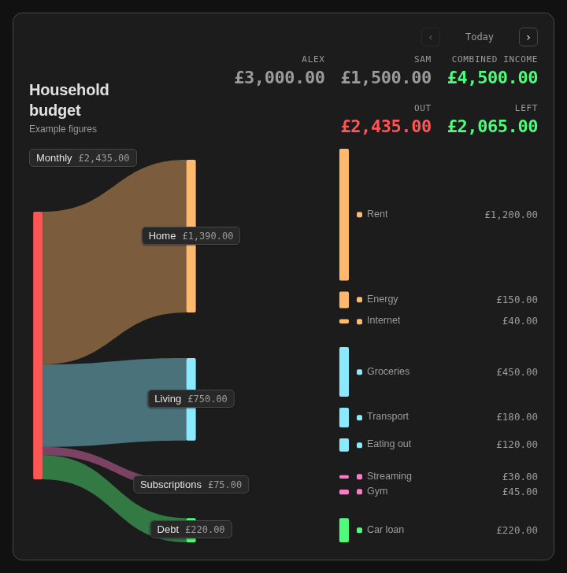
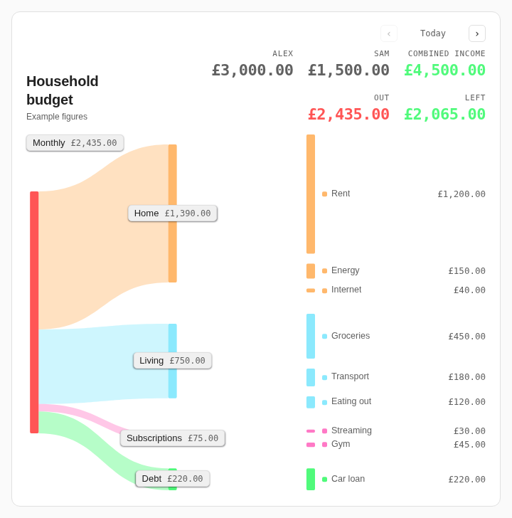
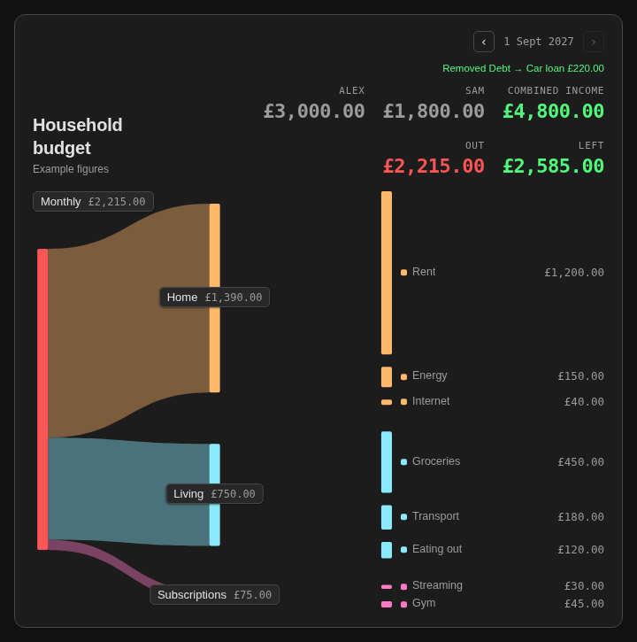

# Budget Sankey Card

A Home Assistant dashboard card that draws your budget as a sankey: total, groups, line items. Figures live in the card's YAML, not in entities. Entries can start and end on set dates, and the card lets you step through upcoming changes.



| Light theme | Upcoming change |
| --- | --- |
|  |  |

## Install

**HACS:** add this repository as a custom repository of type *Dashboard*, then download Budget Sankey Card.

**Manual:** copy `budget-sankey-card.js` to `config/www/`, then add `/local/budget-sankey-card.js` as a JavaScript module resource.

## Usage

```yaml
type: custom:budget-sankey-card
title: Household budget
incomes:
  - [Alex, 3000]
  - { name: Sam, amount: 1500, until: 2027-02-28 }
  - { name: Sam, amount: 1800, from: 2027-03-01 }
groups:
  - name: Home
    items:
      - [Rent, 1200]
      - [Energy, 150]
  - name: Debt
    color: viz-7
    items:
      - { name: Car loan, amount: 220, until: 2030-09-30 }
```

Leave out `income` and `incomes` for a yearly card: it shows the total and the amount to put aside each month.

## Options

| Option | Default | Description |
| --- | --- | --- |
| `groups` | required | List of groups, see below |
| `income` | | Single income; the header shows in, out and left |
| `incomes` | | One entry per earner, instead of `income` |
| `title` | `Budget` | Card title |
| `subtitle` | | Line under the title |
| `root` | `Budget` | Label of the root node |
| `currency` | Home Assistant's | ISO 4217 code, such as `EUR` |
| `locale` | Home Assistant's | BCP 47 tag, such as `de-DE`, for amounts and dates |
| `accent` | `money-out` | Colour of the root node and the outgoing total |
| `show_amounts` | `true` | Show amounts beside line items |
| `monthly_saving` | `true` | Yearly card: show total / 12 |
| `chart_height` | `620` | Scale of the chart in pixels; the card grows if it needs more room |
| `income_label` | `IN` or `COMBINED INCOME` | Income heading |
| `total_label` | `OUT` or `TOTAL` | Total heading |
| `left_label` | `LEFT` | Left over heading |
| `saving_label` | `SAVE / MONTH` | Monthly saving heading |
| `key` | `b` | Prefix for internal node IDs |

**Groups** take a `name`, a list of `items` and an optional `color`.

**Items and incomes** are a `[name, amount]` pair, or a `{name, amount}` mapping. Only the mapping form takes `from` and `until`: `YYYY-MM-DD` dates, both inclusive. Two dated entries with the same name read as one amount changing.

**Colours** are any CSS colour, or a token: `viz-1` to `viz-8`, `money-out`, `pending`, `accent`.
